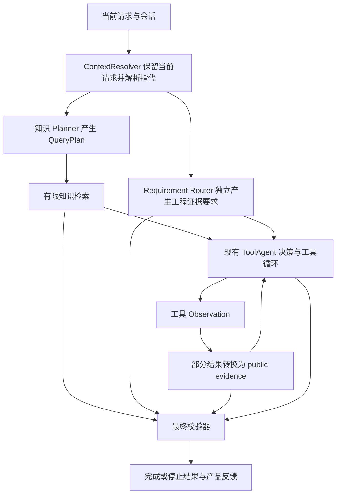

# 证据需求与 Planner 架构复核

日期：2026-10-10。范围：当前共享工作区的实际源码、相关离线回归、合成行为探针，以及 R01 工具评测原始记录。此次不实施业务改造，不调用真实模型，不重跑正式评测。

HEAD：`bdd9faf6addc1ec633de3165a757cb3c2ca866f3`。审查期间 core/api 与依赖配置的业务指纹前后相同：`69951bcb7c87f01ecb3fb5f8e45d57e82f7257a0a81d646bfcba0a7ede7c198b`，共 107 个文件。这是当前未提交工作区的身份，不等于 R01 正式基线指纹。

## 1. 实际主链与职责

- 装配入口是 `api/app.py::_build_engineering_project_runtime`。当前采用知识 Planner overview v5、Decision overview v7、Reader targets v4、code_search v7。平台绑定工具开启后注册八种工具，Engineering 主链禁用 knowledge_search，知识仍由前置检索获取。
- `core/unified_engineering_runtime.py:155-186` 依次调用 Context、Planner、Requirement Router、Retrieval、Verifier bind、唯一执行循环。Router 的输入是 `context_snapshot.lexical_query`，没有 PlannerOutcome 参数。
- `EngineeringEvidencePlanner` 委托既有 `BaseQueryPlanner`，输出只包含知识检索 QueryPlan。知识 Planner 的 Engineering 提示词明确声明：仓库实际取证由独立项目证据要求负责，本计划不能取消该要求。
- Requirement 决定工程材料要求；最终能否提交还由 Verifier 综合检索覆盖、材料结构及引用决定。知识检索覆盖参与最终校验，不等于 Planner 有权另定一份工程 requirement。

**先前将两个独立模块的“规划冲突”作为缺点，是职责分析错误，撤回。** 当前职责可以保持，证据需求模块独立模型化不必修改知识 Planner，也不要求强制建立新的上下游接口。

## 2. 对讨论结论的逐项复核

| 先前判断 | 复核结论 | 源码或记录依据 |
|---|---|---|
| 独立工程模块会带来两份规划冲突 | 错误论据，撤回 | Unified run 中 Router 独立输入；知识提示词禁止取消项目要求 |
| 首期应该合并成一次 Planner 模型调用 | 缺少实测依据，扩大了旧协议改动范围 | BaseQueryPlanner、QueryPlan、解析器与 fallback 都围绕知识检索；保持旧 Planner 更便于分开验收 |
| 现有证据需求太生硬 | 成立，但包括漏匹配与错误材料深度两种问题 | 关键词路由、九种冻结 profile、仅 kind 与路径数量的 evaluator |
| 把 Router 换成模型即可解决主要失败 | 不成立 | 工具来源登记、引用绑定和恢复条件是另外的责任缺口 |
| 先补证据体系投入产出最高 | 是有失败依据的优先级判断，尚非测得的改造收益 | R01 的 13 道目标题已取得材料仍拒答；目前未做修复后的对比评测 |
| 模型化能完全保留旧模块的可复现性 | 必须区分在线再生成与固定记录重放 | 旧 Router 对固定字符串与版本确定；新模型规划需保存才能重放，不能保证在线重生成一致 |
| 旧规则已经具备完整可追踪性 | 需要收窄 | 有版本、profile、缺失 kind 与路径数量；未逐项保存所有命中规则及需求到材料的责任链 |
| 可以完全只改外围 | 范围说得过轻 | 核心数据类型、运行状态、恢复及 API evidence union 都有严格限制；可以保留执行内核，但需要有限接口改动 |

补充：多轮时现有 `lexical_query` 已可能包含模型生成的 reference_context，因此旧 Router 的确定性是对固定输入而言，不能将整条旧链描述为完全无模型不确定性。

## 3. 已确认的四类缺口

### A. 需求表达与分类

`EngineeringEvidenceRequirement` 仅包含固定 profile、required_evidence_groups、min_distinct_project_code_paths 和 router_version；其构造器要求类别与数量严格等于冻结 profile。

它不能表达具体 A/B 对象、定位与实现的深度差异、候选与正文的区别，也不能表达一项已完成另一项缺失。让模型只选择这九种类别，会改善部分分类，却保留上述表达能力缺口。

当前离线探针的结果：

| 请求 | 当前路由 |
|---|---|
| 找到本地项目中 A 和 B 两个函数的位置 | NO_ADDITIONAL_REQUIREMENT |
| 详细解释本地项目中 A 和 B 两个函数的完整实现 | NO_ADDITIONAL_REQUIREMENT |
| 找到当前仓库源码中 A 和 B 两个函数的位置 | PROJECT_CODE_V1，至少一个代码路径 |
| 详细解释当前仓库源码中 A 和 B 两个函数的完整实现 | 相同的 PROJECT_CODE_V1 要求 |
| 查看当前工作区已删除的源码文件有哪些 | PROJECT_CODE_V1，仍要求源码正文 |

这说明同时存在自然语言漏匹配，以及已匹配请求的需求深度不区分，不能仅描述为“所有要求都过严”。

### B. 工具结果到证据的交接

`core/tool_agent/runtime.py:1104-1112` 只转换 knowledge_search、Reader 正文和 git_diff。code_search、changed_files、find_tests 的结果仍可出现在 DecisionContext 的 Observation 中，但没有相应 public evidence 与 E-ID。

这不是工具没有查到资料。R01 原始记录中，dev-013 的 changed_files 成功，requirement 已满足，最终因 ANSWER_EVIDENCE_REFERENCE_MISSING 拒答；其公共来源只有前置知识。dev-015 另有 PROJECT_CODE_V1 错误正文要求，所以同时出现 REQUIRED_EVIDENCE_MISSING。

当前源码的合成全链探针也证实：实际 code_search 成功定位 A，public evidence 数为 0，随后在脚本式最终提交中被 INSUFFICIENT_EVIDENCE_TO_FINALIZE 停止。该探针不调用模型，不作为真实模型通过率。

### C. 结构充分不等于目标充分

`evaluate_evidence_requirement` 只计算 kind 和代码路径数量；`_evaluate_answer_evidence_binding` 检查 E-ID 是否属于本轮，并对引用子集重复相同结构判断。

合成探针实际读取 `src/imports.py` 的一行 `from unrelated import value`，对于“解释 A 和 B 的完整实现”，配合合法 [E1] 时 can_finalize 为 true。它说明结构校验没有核验具体对象与内容支持；不是一项新的真实模型失败记录。

因此，新目标表示与新的逐项覆盖判断需要一起实现。模型理解请求仍可能遗漏目标，程序格式校验也不能证明自然语言理解正确，必须分别评测。

### D. 最终提交修正与取证恢复混用

Verifier 的 recovery_allowed 仅在检索可用、材料结构不足且没有非法知识引用时开启；其结果类型也强制此关系。材料结构已满足、只缺 [E#] 时 recovery_allowed 为 false。

Runtime 的 `_recovery_is_feasible` 还要求剩余工具额度、材料 producer 及后续决策机会；无进展判定依据 evidence fingerprint。它适合继续取证，不能直接复用于“已有资料只需补引用”。

探针读取了 A/B 的正确完整正文后，提交未带引用的正确局部说明，得到 requirement_satisfied=true、binding_status=MISSING、recovery_allowed=false。允许一次受剩余决策额度约束的引用修正，需要明确的恢复类别和有限接口变更，不能声称只改一条提示词即可。

## 4. 需要保留的有效边界

- 现有 ToolAgent 是唯一执行循环，Executor 做真实工具参数和结果校验，工作区与权限由系统绑定，默认预算 5/4/2。证据需求模型不取得工具执行权或预算控制权。
- Reader 的当前 public snippet 已保留全部实际返回的有界文本，不能把旧设计文档中“再次裁成 2000 字符”的历史问题误报为当前 Reader 状态。git_diff 仍有自己的 2000 字符边界。实际返回的文本仍可能包含 Reader 原有的裁切，不能称为原文件全部字符。
- 现有 public project evidence 要求路径、正行号和 snippet，适用于正文；不能把列表硬塞进去或伪造行号。新来源表示需要协调 Runtime、引用控制与 API/前端投影。
- 当前运行状态只有 completed/refused/failed，refused 与 failed 的 answer 必须为 null。用户已有非完成结果反馈，但它按稳定原因码生成固定文案，并非逐项完成报告。模型化需求不自动带来 partial 返回能力。
- 当前产品用量统计主要汇总 Decision，elapsed_ms 覆盖整个请求；执行 deadline 从 ToolAgent 阶段开始。新增需求调用必须独立记录调用、token、超时和降级，不能宣称已有全链硬预算或把额外调用藏进原统计。

## 5. 修正后的首期建议

保持知识 Planner 的接口与职责。改造现有证据需求模块，使用 LLM 替代实现接收当前请求及有界指代信息，生成版本化、可冻结的需求；旧规则保留用于对照和明确回退。证据需求职责继续独立于知识 Planner，但不是在旧 Router 后再新增一个需求模块。共享模型客户端与通用记录机制，不直接复用知识 QueryPlan 的 schema、解析器和知识 fallback。具体改动与对比方案见 [替换计划](../design/engineering_requirement_llm_replacement_plan.md)。

首期需求类型只围绕现有能力：定位、列表、候选、局部正文、实现正文，以及具名的多目标。调查时允许细化未知对象的定位；不能要求规划阶段就预知原因和所有文件，也不能删除用户的必需目标来宣布完成。

实现需分开衡量：需求理解是否正确、实际材料是否对应目标、引用及结束是否正确。来源登记与需求深度必须接通，不单独放宽引用护栏；引用修正与继续取证采用不同的有限反馈。

原 v2 大设计中的预算扩容、写入执行、全链账本、通用结构化陈述协议和新的 partial API 不必一次落地。先验证现有只读任务的取证与结束改善，必要的类型及协议兼容改动单独评审。模型最终语义审查保留为后续候选，不能替代来源验证或端到端答案评测。

## 6. 验证记录与限制

十个现有模块的相关离线回归：**177 passed / 3 依赖警告**。覆盖需求、规划、检索、最终校验、当前请求、引用绑定、证据转换、Reader 公开内容及失败反馈。模型使用 Fake/Scripted，网络拦截记录为 0 次外部或生产 8000 端口连接尝试。不是完整 CI，也不是修复后模型评测。

结果保存于：

- `data/runtime/evidence_arch_review_20261010_tests_checked.xml`。
- `data/runtime/evidence_arch_review_20261010_probes_checked/probes.json` 及合成源码。

初次测试的网络屏蔽过宽，拦截 Windows 异步框架本地 socket，导致 26 个同一原因的失败；修正为允许测试框架本地通信后，重新完整运行上述模块。初次定位探针误传 code_search 不支持的 max_results，属于探针输入错误；校正参数后才用于结论。初次记录保留，不计作业务失败或正式评测。

R01 原始记录只作已知失败依据；当前工作区已包含其后的修复，没有据此宣称当前最新版本仍保持相同通过率。首期收益、模型需求分析质量以及复杂答案正确性仍需冻结新版本与新题后验证。
