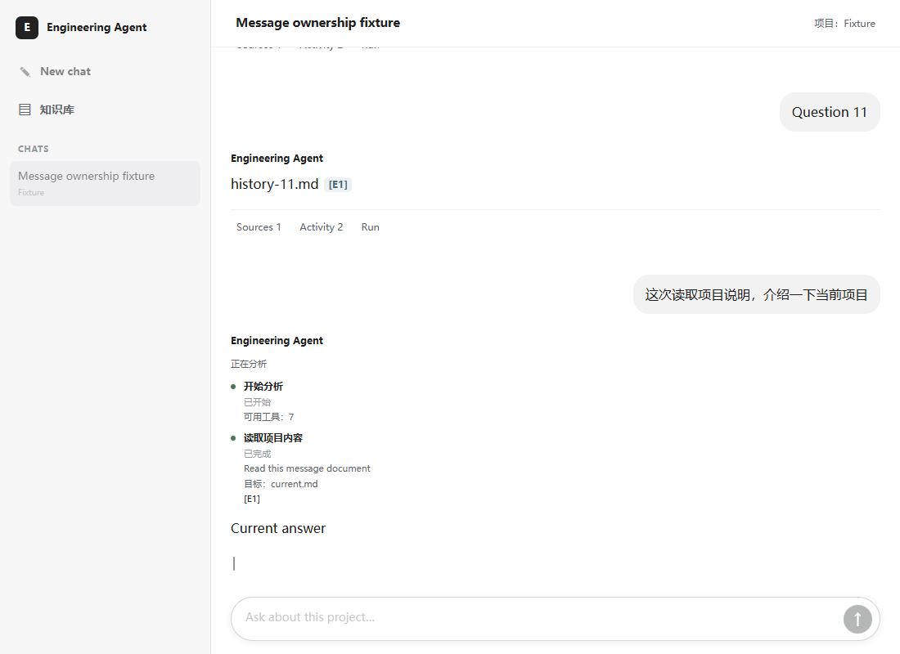

# R10：消息详情归属与实时执行面板位置

日期：2026-10-10。结论：已修复确认成立的前端详情串用风险，并将实时执行过程放入本轮助手回复。项目所有者明确取消 R04，绑定入口保持现有实现。本切片没有修改后端、模型调用、数据库、核心循环、5/4/2 预算或 Evidence/Citation 校验。

## 1. 原截图与数据库的区别

以只读方式查询原会话 `a632c53d96134a70a0f326f2d219396e` 的 8 条消息。记录显示，成功回答与首次拒答保存的资料内容不同，只是证据数量和活动数量相同；两次拒答才保存了相同的证据和活动。这里不能将“Sources 5 / Activity 6 数字相同”直接认定为复用了上次成功结果。

下表 SHA 为排序 JSON 的 UTF-8 SHA256 前 12 位，用于比较实际数组内容，而非只比较数量。

| 回答 | Evidence 数 / SHA | Activity 数 / SHA | 实际 Tool Call |
|---|---|---|---|
| 常见后训练方法，completed | 5 / `6bccc4312938` | 6 / `0ad397dc9581` | 0 |
| 当前绑定目录，refused | 5 / `88bfcc499110` | 6 / `39e2d819d227` | 0 |
| 当前项目介绍，refused | 5 / `88bfcc499110` | 6 / `39e2d819d227` | 0 |

这三个回答的 6 条活动都是 1 条 `run_started` 和 5 条 `evidence_added`，不是 6 次工具调用。成功回答的 E4 来自 `finetuning/微调方法.md`，拒答的 E4 来自 `agent_frameworks/LangChain-LangGraph-03-Checkpoint与人工介入.md`。两次拒答重复取得资料，与 R01 已定位的当前任务被改写为上一轮目录问题一致；R01 已修请求交接，R02/R03 已补绑定事实与概览资料入口。此次不重写或删除历史数据库结果。

## 2. 已成立的前端问题与改动

真实浏览器前置对照复现了三个失败：旧拒答缺少 evidence 字段时错误显示“查看已找到的资料”；旧答案没有自己的 E1 来源时被生成可点击引用；实时面板位于 messages 容器外，固定占据页面底部区域。

修改仅在 `frontend/js/app.js`、`frontend/index.html` 和 `frontend/css/app.css`：

- 历史答案、拒答提示和 Sources/Activity/Run 详情只读取该消息自己的结果。缺字段保留空资料或已记录的 legacy trace，不借用最新结果补齐。
- 抽屉显式记录“本轮实时查看”或“指定消息查看”。历史链接携带该消息结果，实时链接携带实时标记；相同 E1 在不同回答、不同会话中保持各自来源。
- 新一轮 final 更新当前运行数据，保持用户已选历史消息的详情。切换会话/关闭抽屉时清除选择；最新消息缺结果时也不跳过它去认领旧结果。
- 复用现有实时面板节点，将它挂在当前 pending 助手回复中，位于用户问题之后、流式答案之前。每次答案重绘仍保留同一面板，完成和请求错误后退出实时展示；正在跟随会话末尾时，活动增长继续跟随滚动。
- 当前流式答案的引用显式打开实时来源，历史答案则始终使用自己的来源。没有按提问措辞或拒答类别增加特殊展示规则。

## 3. 局部验证

新增可手动执行的真实浏览器回归：[frontend_message_scope.browser.mjs](../../tests/frontend_message_scope.browser.mjs)。使用 Playwright 驱动本机 Edge 的 headless 浏览器，启动随机端口的本地静态服务器，模拟 Conversation API 和受控流式事件。没有启动真实后端、写生产数据库、访问外部站点或调用 DeepSeek。

修复前，对“旧拒答缺字段、旧 E1 无来源、实时面板位置”运行 3 项，**3 项均按预期失败**。修复后完整局部浏览器集 **10 项全部通过，0 跳过**：

| 检查 | 结果 |
|---|---|
| 旧拒答缺字段：提示、来源和活动不借用最新资料 | 通过 |
| 旧答案缺来源：E1 保留文本，不关联到最新 E1 | 通过 |
| 历史引用/活动内引用，刷新前后来源一致 | 通过 |
| 明确空证据的拒答，详情为空且状态为 refused | 通过 |
| 桌面/手机宽度，12 轮长历史，执行面板在当前问题下方；重绘后只有一个面板 | 通过 |
| 实时引用显示当前资料，活动开始/完成更新同一条目 | 通过 |
| 执行中查看历史详情，新一轮完成后仍保持该历史消息 | 通过 |
| 请求错误后实时面板退出，历史来源仍可查看 | 通过 |
| 流式正文/加粗/引用块中的 E1 在 final 前打开本轮资料 | 通过 |
| 切换会话清除旧抽屉，同名 E1 不串会话 | 通过 |

已有局部前端检查：`node --test tests/frontend_feedback.test.mjs tests/frontend_stream_v2.test.mjs`，**29 项全部通过**。`node --check frontend/js/app.js` 和限定前端文件的 `git diff --check` 通过。未执行全盘后端评测。

浏览器复现命令（先指定本机 Playwright 模块目录；没有安装默认 Chromium 时可指定已安装浏览器路径）：

```powershell
$env:ENGINEERING_BROWSER_NODE_MODULES = '<Playwright 所在 node_modules 的绝对路径>'
$env:ENGINEERING_BROWSER_EXECUTABLE = '<已安装 Edge 或 Chromium 的绝对路径>'
node --test tests/frontend_message_scope.browser.mjs
```

该 `.browser.mjs` 是独立的可选浏览器回归，不改变项目依赖或现有 CI。它没有加入默认的无浏览器 `.test.mjs` 检查命令。

以下是测试夹具中的长会话截图，不是真实模型回答，已检查执行面板位于当前问题之后：



## 4. 边界与交付状态

本次保证的是页面消息与已记录结果的归属、实时面板的位置及直接生命周期。它不能让旧错误改写的历史记录自动变成正确答案，也不证明所有真实模型/网络场景都已测试；流式协议解析由已有 29 项前端检查覆盖，新的浏览器检查使用受控事件验证页面行为。

前端页面重新加载后可使用本项修改；浏览器缓存了旧资源时需强制刷新。R01–R03 的后端装配仍需重启旧进程才能加载。当前未提交、未推送，也未替用户重启服务。后续 R05–R09 保留各自范围，不与本次前端修复混入。
